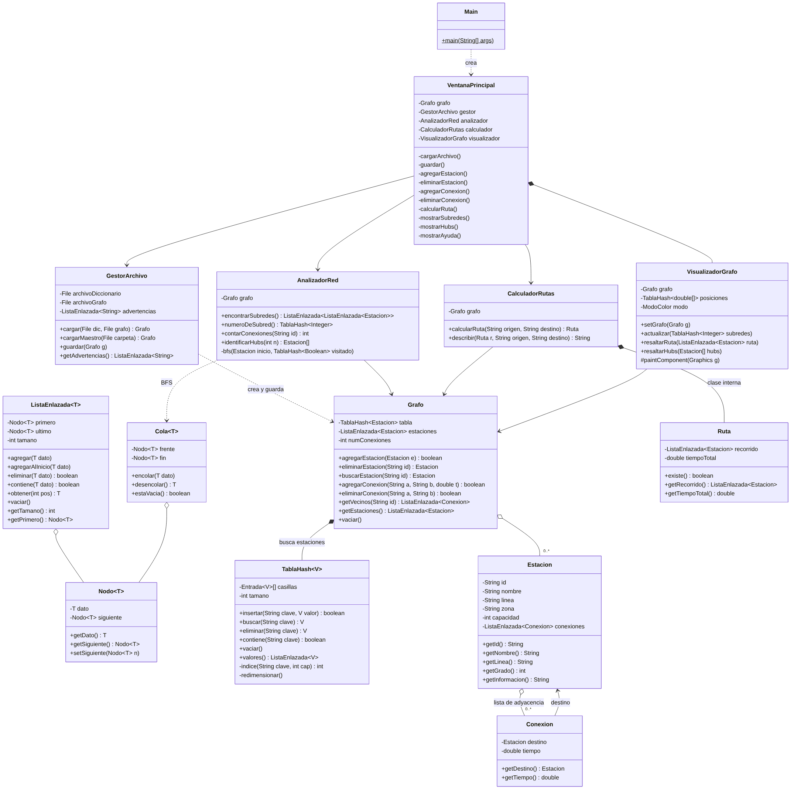

# UrbanRoute

Optimización y análisis de redes de transporte multimodal.
Estructuras de Datos (BPTSP06), Trimestre 2627-1, UNIMET. Profesor Rhadamés Carmona, sección 3.

| Integrante | Cédula | Parte |
|---|---|---|
| Luis Esis | V-33145868 | 1. Estructuras y modelo (`estructuras`, `modelo`) |
| Isabela Centeno | V-31423256 | 2. Control: archivos y algoritmos (`control`, `Cola`) |
| Guillermo Page | V-29611745 | 3. Interfaz gráfica (`vista`, `Main`) |

## Qué hace

La red de transporte se modela como un **grafo no dirigido y ponderado**. Las estaciones son los nodos y los tiempos de traslado en minutos son las aristas. Las estaciones se guardan en una **tabla hash propia**, así que se encuentran por su ID en O(1) sin recorrer la red.

| Req. | Funcionalidad | Clases |
|---|---|---|
| A | Cargar archivos con `JFileChooser` | `VentanaPrincipal`, `GestorArchivo` |
| B | Agregar y eliminar estaciones y conexiones | `VentanaPrincipal`, `Grafo`, `TablaHash` |
| C | Guardar los cambios en el archivo fuente | `GestorArchivo` |
| D | Mostrar el grafo | `VisualizadorGrafo` |
| E | Detectar subredes aisladas (BFS) | `AnalizadorRed` |
| F | Ruta de menor tiempo (Dijkstra) | `CalculadorRutas` |
| G | Identificar hubs (mayor número de conexiones) | `AnalizadorRed` |

No se usa `java.util` para las estructuras: la lista enlazada, la cola y la tabla hash son propias.

## Estructura

```
src/main/java/urbanroute/
├── Main.java
├── estructuras/   Nodo, ListaEnlazada, Cola, TablaHash
├── modelo/        Estacion, Conexion, Grafo
├── control/       GestorArchivo, AnalizadorRed, CalculadorRutas
└── vista/         VisualizadorGrafo, VentanaPrincipal
data/              diccionario.csv y grafo.csv (archivo maestro)
```

## Diagrama de clases



El código fuente del diagrama (Mermaid) está en `docs/diagrama_clases.mmd`.

## Cómo ejecutar

* **NetBeans / IntelliJ:** abrir la carpeta como proyecto Maven y ejecutar `urbanroute.Main`.
* **Consola:** `mvn package` y luego `java -jar target/UrbanRoute-1.0.jar`

El programa se ejecuta desde la carpeta del proyecto y carga al iniciar `data/diccionario.csv` y `data/grafo.csv`. Requiere Java 11 o superior.

## Formato de los archivos

`diccionario.csv` (estaciones):
```
id,nombre,linea,zona,capacidad
L1-01,Propatria,L1,Catia,3000
```

`grafo.csv` (conexiones, en minutos):
```
origen,destino,tiempo
L1-01,L1-02,2
```

* El separador puede ser coma o punto y coma. Si hay encabezado, las columnas se reconocen por su nombre en cualquier orden.
* Las filas con errores se saltan y se reportan: ID repetido, campos vacíos, tiempo no numérico o menor o igual a 0, estación inexistente, conexión repetida o una estación conectada consigo misma.
* Los datos de `data/` son de ejemplo, basados en el Metro de Caracas. Para usar los datos oficiales del curso basta con reemplazar esos archivos.

## Uso del dibujo

Arrastrar una estación la mueve. Arrastrar el fondo desplaza la vista. La rueda del ratón hace zoom. Al pasar el ratón sobre una estación se ven sus datos. La ruta calculada se resalta en amarillo y los hubs con un halo.
